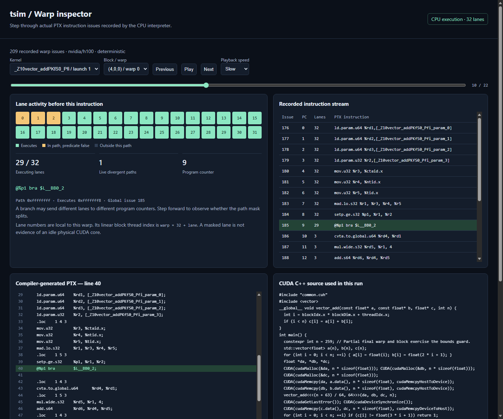

# tsim

Write CUDA C++ on a CPU-only machine and inspect the GPU execution model. `tsim` uses NVIDIA's real `nvcc` compiler to produce PTX, then executes that PTX through a CPU interpreter. CUDA kernel launch syntax, `threadIdx`, `blockIdx`, shared memory, barriers, warp intrinsics, and runtime memory operations remain ordinary CUDA source.

Development is continuing toward broader CUDA conformance and detailed GPU architecture modeling. The [replication roadmap](docs/replication-roadmap.md) records the required tracks and evidence. The current implementation is a functional foundation; the larger replication goal remains open.

The execution engine is [PantheonSim](https://github.com/pantheongpu/pantheonsim), pinned as a submodule rather than presented as original tsim code. tsim adds a reproducible local compiler/runtime setup, Windows-to-WSL launcher, bounded instruction tracing, an offline interactive warp inspector, CUDA examples, and integration verification. The original fluid simulator is preserved in Git history at `1b33446da9fe7b0a8aee40f923a47c4a67a4c087`.

## Get started

On Windows, use Python 3.10+ and an existing Ubuntu WSL distribution with Git, Clang 18+, GNU Make, and GCC 13. Ubuntu 24.04 is the tested environment. On Linux, use the same toolchain and Python 3.10+. No NVIDIA GPU or GPU driver is needed. This implementation targets Linux x86-64; Windows commands invoke Linux through WSL.

Clone with `git clone --recurse-submodules https://github.com/TarunNagarajan/tsim.git`, enter the repository, and run `python tsim.py setup --jobs 2`. Setup downloads CUDA 12.6.3 compiler/runtime/CCCL components from NVIDIA and CMake 3.31.6 from PyPI, verifies archive checksums, and builds the interpreter. Everything is local; it does not install a GPU driver or modify a system CUDA installation. The first build can take several minutes.

If your system drive is short on space, select a cache on another drive: `python tsim.py --cache D:/Codex-work/tsim-cuda-lab setup --jobs 2`. The cache choice is remembered in ignored `.local.json`. Linux accepts a normal Linux path. `--distro` selects a WSL distribution other than Ubuntu. Global options such as `--cache` and `--distro` go before the command.

Run `python tsim.py doctor` to inspect the compiler/runtime, then `python tsim.py run examples/vector_add.cu --trace`. Run `python tsim.py test` for the numerical and diagnostic checks. All compilation and kernel execution occur locally. CUDA syntax is handled by NVIDIA's compiler; tsim does not rewrite kernels into CPU loops.

## Inspect a kernel

The repository includes [an actual recorded vector-add run](demo/inspector.html); download or open that file locally for the offline inspector. Its 209 events come from CPU execution, and machine-specific directory names have been removed from the exported demonstration.

`python tsim.py run examples/divergence.cu --trace` creates a run directory containing `source.cu`, `kernel.ptx`, `program`, `compile.log`, `stdout.log`, `stderr.log`, `run.json`, `warp-trace.jsonl`, and `inspector.html`. Open `inspector.html` in your browser. The report is self-contained and needs no web server or network connection. On Windows, a printed `/mnt/d/...` path corresponds to `D:/...`; `/mnt/c/...` corresponds to `C:/...`.

Select a kernel launch and a block/warp, then use Previous, Next, the position slider, or playback. The inspector shows all 32 lanes, the control-flow path mask, the predicate-adjusted execution mask, the live path count, program counter, PTX instruction, original CUDA source, and actual interpreter counters. Repeated launches of the same kernel have separate launch identifiers. Arrow keys also move between instructions. This is replay of recorded execution; it is not a debugger that edits registers or resumes a paused kernel.

Use `--out PATH` to choose the run directory. `python tsim.py inspect PATH/warp-trace.jsonl` regenerates a report from a saved trace and its sibling artifacts. Source comments and program output are embedded as inert data rather than executable HTML.

## Execution controls

`--scheduler deterministic` is the default. `--scheduler random --seed 7` explores a seeded legal warp schedule; `--scheduler adversarial` switches warps frequently to expose missing synchronization. `--race` checks unordered shared-memory access across warps. `--strict` enables additional interpreter checks, including some that can reject otherwise valid compiler output, so it is optional. Numerical correctness should not depend on one legal schedule.

`--threads 1` is the default and gives a stable event order. A higher value distributes independent blocks over CPU workers; trace ordering then depends on host scheduling. `--trace-limit 200000` bounds the number of recorded events. A truncation record and a visible inspector message identify an incomplete trace; execution continues after the trace cap. `--timeout 60` bounds the program's execution time. Compiler invocations have a separate 180-second timeout. Interpreter runaway protection also limits each warp to ten million instructions.

`--gpu h100` chooses a device profile; `python tsim.py devices` lists available profiles. All tsim compilations currently target `compute_80` PTX, so choose a compatible Ampere-or-newer profile. Profile properties describe a simulated device; they do not turn host RAM into physical GPU memory or provide its performance. Additional compiler options can be passed as `--nvcc-arg=-I/path/to/include`. Pass application arguments after `--`, for example `python tsim.py run my_kernel.cu --trace -- 1024`.

## Examples and verification

`vector_add.cu` checks every element with a partial final block. `index_3d.cu` checks three-dimensional block and thread indexing. `divergence.cu` takes different branches in alternate lanes. `shared_reduce.cu` uses dynamic shared memory and block barriers across four warps. `warp_atomic.cu` combines ballots, synchronized shuffles, and atomic accumulation. `tiled_matmul.cu` checks a tiled 19-by-19 multiplication against a separate serial matrix calculation, including tile boundaries. `multiple_launches.cu` distinguishes successive launches of the same kernel.

`out_of_bounds.cu` and `shared_race.cu` are intentionally invalid. Run them with `--race --trace` to inspect the rejected execution and diagnostic. A nonzero exit is expected. They are excluded from the list of numerically valid programs.

`python tsim.py test` executes the valid examples, verifies their complete host-side references and independent Python summary calculations, repeats synchronized kernels under different schedules, compares traced and untraced results, checks deterministic trace replay and mask invariants, verifies intentional faults, exercises the trace cap, and checks report data escaping. Results and all run artifacts are saved under the cache's `verification/` directory. These tests establish the stated examples on the CPU interpreter. They are not hardware differential validation for all CUDA instructions.

The [recorded verification report](docs/verification.json) documents 16 passing CUDA execution checks on an Intel i5-1135G7 with Ubuntu WSL, exact PTX alignment for 5,602 recorded issues across 14 saved runs, and 13 actual browser checks of the inspector. A separate [clean-checkout GitHub run](https://github.com/TarunNagarajan/tsim/actions/runs/38073798643) built the toolchain/runtime and passed all 16 execution checks. Intentional invalid kernels pass their checks by returning the expected diagnostic and nonzero exit.

An optional installed Chromium/Chrome/Edge browser can verify the inspector itself with `python scripts/browser_check.py PATH/inspector.html --browser PATH_TO_BROWSER --out PATH_TO_UI_RESULTS`. It runs the actual HTML in headless mode, checks navigation, playback, selection and lane-mask rendering, and writes a screenshot and result JSON. Browser profiles and temporary files stay in the selected output directory.

`python tsim.py conformance` builds and executes eight pinned upstream PTX, execution, fast-path, barrier, memory and register-allocation suites. The [core report](docs/core-conformance.json) records 358 passing checks after repairing a Clang signaling-NaN regression in double atomic addition. These are functional regression tests, not physical-GPU differential validation. Build and individual suite logs are retained under `core-conformance/` in the selected cache.

`python tsim.py source-conformance` runs CUDA feature references and intentional synchronization faults across A100/H100 profiles and three schedules. The [source report](docs/source-conformance.json) records 96 passing cases. It checks warp collectives, divergent device calls, numerical edge cases, memory spaces, direct and transitive publication, and counted barriers. The [compatibility inventory](docs/compatibility.json) maps each tested subset to its evidence. The [shared-memory ordering model](docs/shared-memory-ordering.md) documents the implemented happens-before rules and remaining coverage gaps. Artifacts stay under `source-conformance/`; each compiled program is replayed with verified hashes across the matrix.

`python tsim.py run examples/vector_add.cu --events` records typed instruction dependencies, call-frame identities, launch resources and successful per-lane memory addresses. The [execution-event contract](docs/execution-events.md) describes scope, truncation, faults and explicit coverage gaps. `python tsim.py event-conformance` verifies 114 analytical checks, including mixed generic memory spaces, exact scalar atomic counts, four-worker parent identities and capture equivalence. The [event report](docs/event-conformance.json) records the result. Event summaries count logical accesses, not hardware transactions or cycles.

`python tsim.py memory-report RUN_DIRECTORY` derives logical global sectors, shared byte-span bank topology, private local stripes and constant-address requests from a complete capture. `python tsim.py memory-conformance` verifies 77 analytical and CUDA integration checks. The [memory-model contract](docs/memory-model.md) describes the model and a separately tested configurable sector-cache component. `python tsim.py cache-report RUN_DIRECTORY` replays a configurable private-L1/shared-L2 sector hierarchy with explicit policies and assumptions; `cache-conformance` verifies 76 checks. The [cache contract](docs/cache-hierarchy.md) describes supported traffic and rejected hints. `python tsim.py residency-report RUN_DIRECTORY` reports SM resource ceilings from labeled PTX estimates. `residency-conformance` passes 61 checks and 3872 comparisons against NVIDIA's standalone occupancy SDK, including Hopper barrier limits; see the [residency contract](docs/sm-residency.md). Scheduling and timing remain under development.

`python tsim.py compile-resources RUN_DIRECTORY` compiles the verified PTX with NVIDIA ptxas and cross-checks registers, stacks, shared allocation and constant banks with cuobjdump. `residency-report RUN_DIRECTORY --compiler-resources RUN_DIRECTORY/compiler-resources` uses this compiler evidence, preserving the original PTX estimates separately. `compiler-conformance` passes 91 checks covering numerical CUDA references, real spills and stack allocations, shared-prefix padding, failed runs and altered provenance; see the [compiler resource contract](docs/compiler-resources.md). Compiler allocation is evidence for resource ceilings, while dynamic compiler-generated spill traffic and achieved occupancy require further modeling and validation.

`python tsim.py dependency-report RUN_DIRECTORY` builds an observed per-lane RAW/WAR/WAW graph from explicit virtual registers, predicate guards, implicit carry/borrow flags and executed collective transfers. `dependency-conformance` passes 359 checks, including exact source-to-destination lane dependencies, in-place shuffles with different lane writers, precise parked membership reads, legal matching result sinks and four-worker ownership. Five exact PTX inputs also pass pinned NVIDIA assembler and compiler-artifact checks. The [dependency contract](docs/register-dependencies.md) describes directed edges, frame ownership and unknown live-ins; the [collective capture contract](docs/collective-events.md) distinguishes selected issue attempts from actual dispatch groups. Call ABI dependencies and a complete scoreboard remain under development.

`python tsim.py execution-report RUN_DIRECTORY` combines admission, warp placement, observed register hazards and finite pipelines. `--config examples/sm_timing.json` declares timing assumptions; `--memory-config examples/sm_memory.json` enables actual sector requests, completion-time cache fills, miss merging and bounded writeback queues; `--compiler-resources PATH` uses verified allocations for admission. `execution-conformance` passes 476 checks and 106 independent CUDA schedule audits for readiness, queue capacity, resource lifetimes and cross-launch throughput. The [SM contract](docs/sm-execution.md) and [global memory service](docs/sector-memory-service.md) describe the integrated model. Model cycles remain uncalibrated; full synchronization/scoreboard readiness, other memory spaces, data/ordering semantics, physical instructions and hardware differential validation remain open.

[CTA barrier phases](docs/cta-barriers.md) now use independent per-ID state, saved reduction results and explicit scheduling yields for final blocking arrivals. Functional regressions cover crossed IDs, duplicate arrivals, early exits, partial blocks and repeated producer/consumer handoffs. `python tsim.py barrier-report RUN_DIRECTORY` now exports actual phase causes and waiter control gates from compiler-verified capture. [Configured CTA readiness](docs/cta-barrier-timing.md) now joins phase causes with prior-memory completion and finite release service; shared-bank service and complete memory visibility remain open.

## Fidelity and boundaries

This is functional GPU simulation. Warps, per-lane registers, divergence, memory spaces, barriers, and supported PTX instructions are executed by the upstream engine. tsim's trace hooks record actual interpreter state immediately before each issued instruction, including instructions on the fast execution path. The recorded PTX line refers to the compiled PTX file, not directly to the CUDA source line. Device-function calls use the currently executing function's program counter.

Cache traffic and SM resource ceilings have separate models with documented assumptions. GPU issue scheduling, finite pipelines and global memory queues have an optional model with explicit uncalibrated parameters; complete control readiness and hardware cycle equivalence remain open. CPU wall time is not an estimate of GPU time. This environment cannot provide NVIDIA hardware throughput. Shared memory is initially zeroed by the engine, while physical hardware leaves it undefined. Floating-point corner cases and scheduling may differ from a physical GPU. The upstream engine has documented limitations in instruction coverage and control-flow reconvergence; unsupported forms must be investigated from their diagnostic rather than assumed compatible. Physical-GPU validation is still required before relying on a kernel in production.

This project focuses on your own CUDA C++ programs and learning execution semantics. It does not promise arbitrary prebuilt applications, cuBLAS/cuDNN/PyTorch, graphics APIs, or native Windows CUDA binary compatibility. The launcher links shared CUDA runtime, embeds PTX, and explicitly selects CPU PTX interpretation with `VGPU_SASS=0`.

## Source layout and licensing

`tsim.py` is the CLI and WSL bridge. `scripts/setup.py` downloads verified compiler archives and builds the pinned engine. `include/tsim/warp_trace.hpp` writes bounded JSONL traces. `patches/` contains the replayable trace hook and compiler-portability changes applied to the submodule. `scripts/inspector.py` packages the report and `ui/inspector.html` renders it. `scripts/verify.py` implements the integration checks. `examples/` contains normal CUDA source.

`include/tsim/execution_events.hpp` writes architecture input events; `scripts/execution_events.py` validates them. `scripts/engine_patches.py` replays the ordered patch stack from pinned Git objects, upgrades recognized older stack states and preserves unknown local edits.

tsim's additions are licensed under Apache-2.0, as is PantheonSim; see `LICENSE` and `THIRD_PARTY.md`. NVIDIA compiler components retain NVIDIA's licenses and are downloaded locally, not committed or redistributed in this repository. CUDA and NVIDIA are trademarks of NVIDIA Corporation. This project is not affiliated with NVIDIA or the PantheonSim authors.

Shared bank completion now feeds the SM scheduler and CTA release prefixes. The [shared service](docs/shared-bank-service.md) preserves actual vector/subword/64-bit byte traffic and scalar shared atomic32/64 updates, with finite bank queues and indivisible global/shared LSU response joins. 476 execution checks and 106 independent schedule audits pass; the new CUDA source matrix checks 2,688 host values per run with four workers. Logical PTX word traffic, port sharing and model latency remain explicit assumptions without SASS or hardware calibration.
